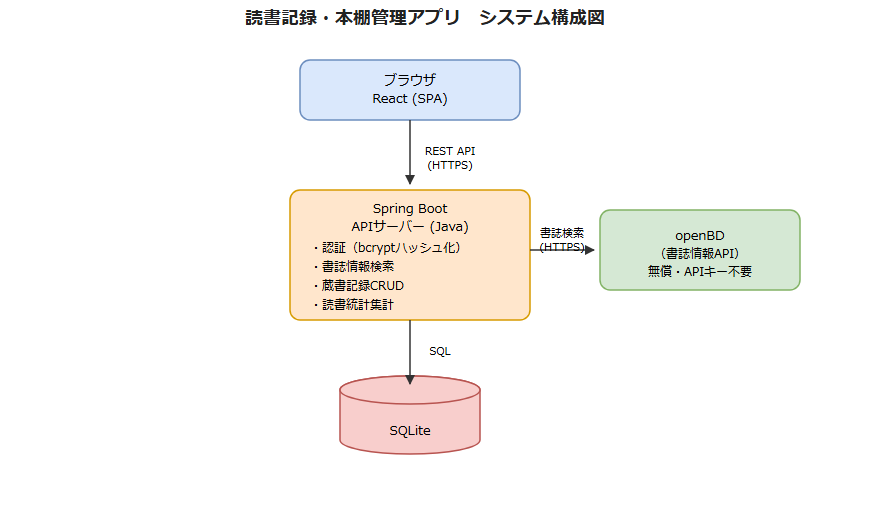

# 基本設計書（外部設計）

| 項目 | 内容 |
|------|------|
| 作成日 | 2026-07-03 |
| 作成者 | sht |
| 版数 | v0.1 |
| 関連文書 | 要件定義書（`docs/01_requirements/要件定義書.md`） |

## 1. システム概要
本システムは、ユーザーが読んだ本をISBN・タイトル検索で取得した書誌情報とともに記録し、読書ステータス・読了日・感想・評価を付与して、本棚形式の一覧や統計画面であとから振り返られるWebアプリケーションである。書誌情報の取得には無償のopenBD API（ISBN検索）と国立国会図書館サーチAPI（タイトル検索）を利用し、個人開発として低コストで運用できる構成とする。

## 2. システム構成図

編集可能な元データは [`システム構成図.drawio`](./システム構成図.drawio)（draw.io / diagrams.net で開いて編集）を参照。

- フロントエンド: React（SPA）
- バックエンド: Java + Spring Boot によるREST API
- データベース: SQLite
- 外部連携: openBD（ISBN検索、無償・APIキー不要）、国立国会図書館サーチ（タイトル検索、無償・APIキー不要）
  - ※openBDはISBN指定での書誌情報取得のみに対応しタイトル検索の機能を持たないため、タイトル検索は国立国会図書館サーチAPI（SRU、dcndlスキーマ）を利用する

## 3. 機能一覧

| ID | 機能名 | 概要 | 対応する要件ID |
|----|--------|------|----------------|
| F-001 | ユーザー登録・ログイン | メールアドレス＋パスワードでアカウント作成・認証を行う | FR-001 |
| F-002 | 書誌情報検索・取得 | ISBNの場合はopenBD、タイトルの場合は国立国会図書館サーチを検索し、書誌情報を取得する | FR-002 |
| F-003 | 蔵書記録の新規作成 | 取得した書誌情報にステータス・読了日・感想・評価を付与して記録する | FR-003 |
| F-004 | 蔵書記録の一覧表示（本棚） | 登録した本を本棚形式・一覧形式で表示する | FR-004 |
| F-005 | 蔵書記録の編集・削除 | 作成済みの蔵書記録を編集・削除する | FR-005 |
| F-006 | ジャンル・タグ付け | 蔵書記録にジャンルやタグを設定する | FR-006 |
| F-007 | 読書統計表示 | 年間読了冊数やジャンル内訳等の統計を表示する | FR-007 |
| F-008 | 蔵書記録の検索・絞り込み | タイトル・著者・ジャンル・ステータスで蔵書記録を検索する | FR-008 |

## 4. 画面一覧
詳細は `画面設計書.md` を参照。

| 画面ID | 画面名 | 概要 |
|--------|--------|------|
| SC-001 | ログイン画面 | メールアドレス・パスワードによるログイン |
| SC-002 | 会員登録画面 | 新規アカウント登録 |
| SC-003 | 蔵書一覧（本棚）画面 | 登録済みの本を本棚形式・一覧形式で表示。検索・絞り込みも行う |
| SC-004 | 書籍検索画面 | ISBN・タイトルで書誌情報を検索する |
| SC-005 | 蔵書登録画面 | 検索結果の書誌情報にステータス・感想・評価を入力して登録する |
| SC-006 | 蔵書詳細画面 | 1件の蔵書記録の書誌情報・ステータス・感想・評価・ジャンルを表示する |
| SC-007 | 蔵書編集画面 | 蔵書記録のステータス・感想・評価・ジャンルを編集する |
| SC-008 | 読書統計画面 | 年間読了冊数、ジャンル内訳などの統計を表示する |

## 5. API一覧
詳細は `API仕様書.md` を参照。

| API ID | メソッド | エンドポイント | 概要 |
|--------|---------|----------------|------|
| API-001 | POST | /api/auth/register | ユーザー新規登録 |
| API-002 | POST | /api/auth/login | ログイン（認証） |
| API-003 | GET | /api/books/search | ISBN・タイトルによる書誌情報検索（ISBN: openBD連携／タイトル: 国立国会図書館サーチ連携） |
| API-004 | GET | /api/records | 蔵書記録一覧取得（検索・絞り込み条件を含む） |
| API-005 | POST | /api/records | 蔵書記録新規作成 |
| API-006 | GET | /api/records/{id} | 蔵書記録詳細取得 |
| API-007 | PUT | /api/records/{id} | 蔵書記録更新 |
| API-008 | DELETE | /api/records/{id} | 蔵書記録削除 |
| API-009 | GET | /api/stats | 読書統計取得 |

## 6. データ構成概要
論理データモデル（エンティティ・属性・関連）を示す。物理的な型・制約・インデックス等の定義は `DB設計書.md`（詳細設計）を参照。

### 6.1 エンティティ関連

- User（ユーザー） 1 : N BookRecord（蔵書記録）　※1人のユーザーは複数の蔵書記録を持つ
- BookRecord（蔵書記録） N : M Genre（ジャンル）　※中間エンティティ BookRecordGenre を介した多対多の関連

### 6.2 User（ユーザー）

| 属性名 | 論理的な意味 | 備考 |
|--------|------|------|
| id | ユーザーを一意に識別するID | 主キー |
| email | ログインに使用するメールアドレス | 一意（重複不可） |
| passwordHash | ハッシュ化されたパスワード | 平文パスワードは保持しない |
| createdAt | 登録日時 | |
| updatedAt | 更新日時 | |

### 6.3 BookRecord（蔵書記録）

| 属性名 | 論理的な意味 | 備考 |
|--------|------|------|
| id | 蔵書記録を一意に識別するID | 主キー |
| userId | 記録の所有者 | Userへの外部キー |
| isbn | 書籍のISBN | openBDまたは国立国会図書館サーチの検索結果に基づき設定。国立国会図書館サーチはISBNを持たない資料もあるためnull許容 |
| title | 書名 | |
| author | 著者名 | |
| publisher | 出版社名 | |
| coverImageUrl | 表紙画像のURL | |
| status | 読書ステータス | 未読／読書中／読了のいずれか |
| finishedDate | 読了日 | statusが「読了」の場合のみ設定 |
| review | 感想 | 最大1000文字 |
| rating | 評価 | 1〜5の整数、未評価はnull |
| createdAt | 登録日時 | |
| updatedAt | 更新日時 | |

### 6.4 Genre（ジャンル）

| 属性名 | 論理的な意味 | 備考 |
|--------|------|------|
| id | ジャンルを一意に識別するID | 主キー |
| name | ジャンル名（例: 小説、ビジネス、ラーメン等の分類名） | 一意（重複不可） |

### 6.5 BookRecordGenre（蔵書記録とジャンルの中間エンティティ）

| 属性名 | 論理的な意味 | 備考 |
|--------|------|------|
| bookRecordId | 対象の蔵書記録 | BookRecordへの外部キー |
| genreId | 対象のジャンル | Genreへの外部キー |

## 7. 外部インターフェース

| 連携先 | 用途 | 方式 |
|--------|------|------|
| openBD | ISBNによる書誌情報（書名・著者・出版社・表紙画像等）の取得 | REST API（HTTPS、無償、APIキー不要） |
| 国立国会図書館サーチ | タイトルによる書誌情報（書名・著者・出版社等、表紙画像は取得不可）の検索 | SRU（HTTPS、無償、APIキー不要、recordSchema=dcndl） |

## 8. 非機能設計方針
要件定義書の非機能要件は現時点で数値未確定（＜要確認＞）だが、個人開発向けの一般的な方針として以下を暫定的な設計方針とする。確定後に本節・要件定義書双方を更新する。

- **性能**: 主要画面（一覧・検索）のデータ取得を3秒以内に完了することを目標とする
- **セキュリティ**: パスワードはbcryptでハッシュ化して保存。API・画面間の通信はすべてHTTPS化。認証にはSpring Securityによるトークンベース認証（JWT等）を想定
- **可用性**: 個人開発のためSLAは定めず、ベストエフォート運用とする
- **保守性**: アプリケーションログは3ヶ月保持。SQLiteファイルは週次でバックアップを取得する
