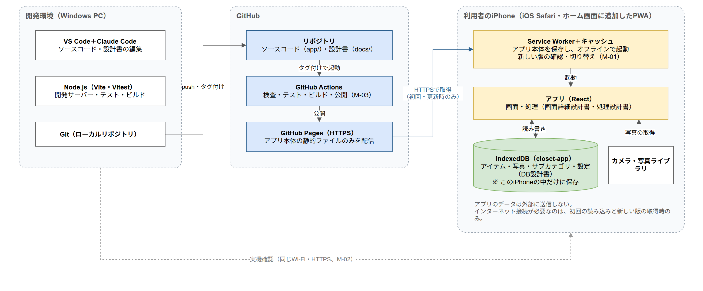

# 方式設計書 共通（概要・システム構成）

| 項目 | 内容 |
|------|------|
| 作成日 | 2026-11-07 |
| 作成者 | sht |
| 版数 | v0.1 |
| 関連文書 | 要件定義書 v0.4（`docs/01_requirements/要件定義書.md`）、処理設計書（`docs/02_design/02_detailed/処理設計書/`）、DB設計書（`docs/02_design/02_detailed/DB設計書/`）、テスト方針書（`docs/03_test/テスト方針書.md`）、合意事項・変更履歴（`docs/00_knowledge/合意事項・変更履歴.md`） |

### 改訂履歴

| 版数 | 日付 | 内容 |
|------|------|------|
| v0.1 | 2026-11-07 | 初版作成 |

## 1. 本書の目的
方式設計書は、アプリの機能そのものではなく「どのような仕組み・環境で作り、届け、動かし続けるか」を定める。画面・処理・データの設計書では扱わない、以下の事項を対象とする。

- アプリをiPhoneに届け、オフラインで動かし、新しい版に切り替える仕組み（PWA）
- 開発環境、ソースコードの置き場所、コーディング規約、実機での確認方法
- ビルドと公開（デプロイ）の手順、版数の付け方
- セキュリティとプライバシーの対策

方式設計書はテーマ単位でファイルを分ける。本書は全体の構成と一覧を示す。

## 2. ファイル一覧・作成状況

| ID | テーマ | ファイル | 状態 |
|----|-------|---------|------|
| ― | 共通（概要・システム構成） | `00_共通.md` | v0.1 合意済み |
| M-01 | PWA・アプリ更新 | `M-01_PWA・アプリ更新.md` | v0.1 合意済み |
| M-02 | 開発環境・規約 | `M-02_開発環境・規約.md` | v0.1 合意済み |
| M-03 | ビルド・デプロイ | `M-03_ビルド・デプロイ.md` | v0.1 合意済み |
| M-04 | セキュリティ・プライバシー | `M-04_セキュリティ・プライバシー.md` | v0.1 合意済み |

## 3. システム構成図
編集用の原本は `システム構成図.drawio`（draw.io形式）。修正時は原本を編集し、PNGを書き出し直すこと。

## 4. 構成要素

| 構成要素 | 役割 | 詳細 |
|---------|------|------|
| 開発環境（Windows PC） | ソースコード・設計書の編集、開発サーバーでの動作確認、テスト、ビルド | M-02 |
| GitHub リポジトリ | ソースコードと設計書の管理 | M-02、M-03 |
| GitHub Actions | 検査・テスト・ビルド・公開の自動実行 | M-03 |
| 公開先（GitHub Pages を想定） | アプリ本体（HTML・JavaScript・CSS・アイコン）を HTTPS で配信する。利用者のデータは置かない | M-03 |
| iPhone（Safari・PWA） | アプリの実行。Service Worker がアプリ本体を保存してオフラインで起動し、IndexedDB に利用者のデータを保存する | M-01、DB設計書 |

## 5. 全体の方針
- サーバー側の処理・データは持たない。公開先はアプリ本体のファイルを配信するだけとする
- アプリが使う外部のサービス・ファイル（フォント、CDN、解析ツール等）はなく、必要なものはすべてアプリ本体に含める（オフライン動作とプライバシーのため。M-04）
- 運用費は無料の範囲に収める（要件定義書 7章）
