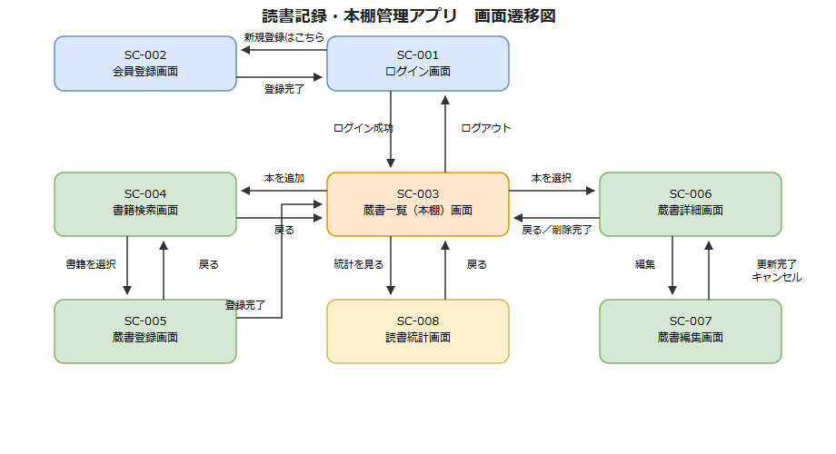

# 画面設計書

| 項目 | 内容 |
|------|------|
| 作成日 | 2026-08-08 |
| 作成者 | sht |
| 版数 | v0.1 |

## 1. 画面一覧

| 画面ID | 画面名 | URL／パス | 概要 |
|--------|--------|-----------|------|
| SC-001 | ログイン画面 | /login | メールアドレス・パスワードによるログイン |
| SC-002 | 会員登録画面 | /register | 新規アカウント登録 |
| SC-003 | 蔵書一覧（本棚）画面 | /books | 登録済みの本を本棚形式・一覧形式で表示。検索・絞り込みも行う |
| SC-004 | 書籍検索画面 | /books/search | ISBN・タイトルで書誌情報を検索する |
| SC-005 | 蔵書登録画面 | /books/new | 検索結果の書誌情報にステータス・感想・評価を入力して登録する |
| SC-006 | 蔵書詳細画面 | /books/{id} | 1件の蔵書記録の書誌情報・ステータス・感想・評価・ジャンルを表示する |
| SC-007 | 蔵書編集画面 | /books/{id}/edit | 蔵書記録のステータス・感想・評価・ジャンルを編集する |
| SC-008 | 読書統計画面 | /stats | 年間読了冊数、ジャンル内訳などの統計を表示する |

## 2. 画面遷移図

編集可能な元データは [`画面遷移図.drawio`](./画面遷移図.drawio)（draw.io / diagrams.net で開いて編集）を参照。

- SC-001（ログイン画面）⇄ SC-002（会員登録画面）: 「新規登録はこちら」で遷移、登録完了でログイン画面に戻る
- SC-001 → ログイン成功 → SC-003（蔵書一覧）。SC-003がハブとなり、各画面に遷移する
- SC-003 ⇄ SC-004（書籍検索画面）: 「本を追加」で遷移、戻るボタンで一覧に戻る
- SC-004 ⇄ SC-005（蔵書登録画面）: 書籍を選択して遷移、登録完了で一覧に戻る（戻るボタンで検索画面にも戻れる）
- SC-003 ⇄ SC-006（蔵書詳細画面）: 一覧から本を選択して遷移、戻る／削除完了で一覧に戻る
- SC-006 ⇄ SC-007（蔵書編集画面）: 「編集」で遷移、更新完了・キャンセルで詳細画面に戻る
- SC-003 ⇄ SC-008（読書統計画面）: 「統計を見る」で遷移、戻るボタンで一覧に戻る
- SC-003 → SC-001: ログアウトで遷移

## 3. 画面レイアウト
詳細なワイヤーフレームは今後の実装時に詰める前提のラフ構成。

### SC-001 ログイン画面
メールアドレス入力欄、パスワード入力欄、ログインボタン、「新規登録はこちら」リンクを縦に配置したシンプルな1カラム構成。

### SC-002 会員登録画面
メールアドレス、パスワード、パスワード（確認用）の入力欄、登録ボタンを縦に配置。SC-001と同様の1カラム構成。

### SC-003 蔵書一覧（本棚）画面
上部にキーワード・ジャンル・ステータスの検索／絞り込みバー、「本を追加」ボタン、統計画面へのリンク、ログアウトボタン。下部に表紙画像・タイトル・著者を並べた本棚形式（グリッド）のカード一覧。

### SC-004 書籍検索画面
ISBNまたはタイトルの入力欄と検索ボタンを上部に配置。検索結果は表紙画像・タイトル・著者・出版社を含むカードのリストで表示し、各カードに「この本を登録」ボタンを配置。

### SC-005 蔵書登録画面
上部に選択した書誌情報（タイトル・著者・出版社・表紙画像）を読み取り専用で表示。下部に読書ステータス・読了日・感想・評価・ジャンルの入力フォームと登録ボタンを配置。

### SC-006 蔵書詳細画面
書誌情報（表紙・タイトル・著者・出版社）、読書ステータス・読了日・感想・評価・ジャンルを表示。「編集」「削除」「一覧に戻る」ボタンを配置。

### SC-007 蔵書編集画面
SC-005と同様のフォームレイアウトで、既存の登録内容を初期値として表示。「更新」「キャンセル」ボタンを配置。

### SC-008 読書統計画面
年を選択するセレクトボックス、選択年の読了冊数、ジャンル別内訳（グラフまたは表）を表示。

## 4. 入力項目定義

### SC-001 ログイン画面

| 項目名 | 型 | 必須 | 初期値 | 備考 |
|--------|----|------|--------|------|
| メールアドレス | text（email） | ○ | - | ログインID |
| パスワード | password | ○ | - | |

### SC-002 会員登録画面

| 項目名 | 型 | 必須 | 初期値 | 備考 |
|--------|----|------|--------|------|
| メールアドレス | text（email） | ○ | - | ログインIDとして使用 |
| パスワード | password | ○ | - | |
| パスワード（確認用） | password | ○ | - | パスワードと一致すること |

### SC-003 蔵書一覧（本棚）画面（検索・絞り込み欄）

| 項目名 | 型 | 必須 | 初期値 | 備考 |
|--------|----|------|--------|------|
| キーワード | text | - | 空 | タイトル・著者を対象に部分一致検索 |
| ジャンル | select（複数可） | - | 未選択 | 登録済みジャンルの一覧から選択 |
| 読書ステータス | select | - | 未選択（すべて） | 未読／読書中／読了 |

### SC-004 書籍検索画面

| 項目名 | 型 | 必須 | 初期値 | 備考 |
|--------|----|------|--------|------|
| 検索キーワード | text | ○ | - | ISBN、またはタイトルの一部を入力 |

### SC-005 蔵書登録画面 ／ SC-007 蔵書編集画面

| 項目名 | 型 | 必須 | 初期値 | 備考 |
|--------|----|------|--------|------|
| 読書ステータス | select | ○ | 未読 | 未読／読書中／読了 |
| 読了日 | date | ステータスが「読了」の場合のみ○ | 空 | ステータスが「読了」以外の場合は入力不可 |
| 感想 | textarea | - | 空 | 最大1000文字 |
| 評価 | select（1〜5） | - | 未選択 | 5段階評価 |
| ジャンル | select（複数可） | - | 未選択 | 既存ジャンルからの選択、または新規タグ入力 |

### SC-008 読書統計画面

| 項目名 | 型 | 必須 | 初期値 | 備考 |
|--------|----|------|--------|------|
| 対象年 | select | - | 当年 | 統計を集計する対象年 |

### SC-006 蔵書詳細画面
表示専用の画面のため、入力項目はなし。

## 5. バリデーションルール

### SC-001 ログイン画面

| 項目名 | ルール |
|--------|--------|
| メールアドレス | 必須、メールアドレス形式 |
| パスワード | 必須 |

### SC-002 会員登録画面

| 項目名 | ルール |
|--------|--------|
| メールアドレス | 必須、メールアドレス形式、未登録のメールアドレスであること（重複不可） |
| パスワード | 必須、8文字以上、英字と数字を含むこと |
| パスワード（確認用） | 必須、パスワードと完全一致すること |

### SC-004 書籍検索画面

| 項目名 | ルール |
|--------|--------|
| 検索キーワード | 必須。ISBNとして扱う場合は10桁または13桁の半角数字（ハイフン可） |

### SC-005 蔵書登録画面 ／ SC-007 蔵書編集画面

| 項目名 | ルール |
|--------|--------|
| 読書ステータス | 必須 |
| 読了日 | 読書ステータスが「読了」の場合必須。本日以前の日付のみ入力可（未来日不可） |
| 感想 | 最大1000文字 |
| 評価 | 1〜5の整数のみ |

## 6. エラーメッセージ一覧

| エラーID | 発生画面 | 発生条件 | メッセージ |
|---------|---------|---------|-----------|
| ERR-001 | SC-001 | メールアドレスまたはパスワードが未入力 | メールアドレスとパスワードを入力してください |
| ERR-002 | SC-001 | メールアドレスとパスワードの組み合わせが一致しない | メールアドレスまたはパスワードが正しくありません |
| ERR-003 | SC-002 | 入力済みのメールアドレスで登録しようとした | このメールアドレスは既に登録されています |
| ERR-004 | SC-002 | パスワードとパスワード（確認用）が一致しない | パスワードが一致しません |
| ERR-005 | SC-002 | パスワードが8文字未満、または英数字混在でない | パスワードは英数字を含む8文字以上で入力してください |
| ERR-006 | SC-004 | 検索条件に一致する書誌情報が見つからない | 該当する書籍が見つかりませんでした |
| ERR-007 | SC-004 | openBD APIとの通信に失敗した | 書誌情報の取得に失敗しました。時間をおいて再度お試しください |
| ERR-008 | SC-005／SC-007 | 読書ステータスが「読了」なのに読了日が未入力 | 読了日を入力してください |
| ERR-009 | SC-005／SC-007 | 読了日に未来日を指定した | 読了日には本日以前の日付を指定してください |
| ERR-010 | SC-006 | 蔵書記録の削除処理が失敗した | 削除に失敗しました。時間をおいて再度お試しください |
| ERR-011 | SC-003 | 検索・絞り込み条件に一致する蔵書記録が0件 | 該当する本が見つかりませんでした |
