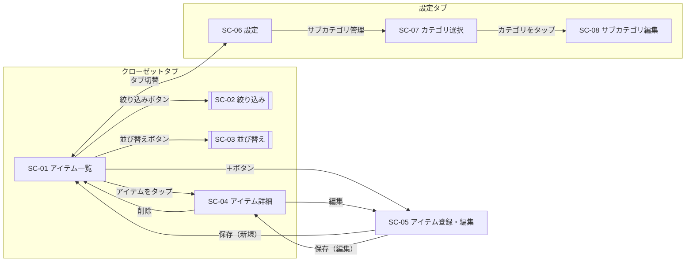

# 画面設計書（案）

| 項目 | 内容 |
|------|------|
| 作成日 | 2026-11-07 |
| 作成者 | sht |
| 版数 | v0.2 |
| 関連文書 | 要件定義書 v0.4（`docs/01_requirements/要件定義書.md`）、画面モック（`docs/02_design/01_basic/画面モック/index.html`） |

### 改訂履歴

| 版数 | 日付 | 内容 |
|------|------|------|
| v0.1 | 2026-11-07 | レビュー用ドラフト作成 |
| v0.2 | 2026-11-07 | レビュー結果を反映。レイアウト・画面項目・画面定義および主要業務／機能シナリオについて合意（7章） |

本書は画面モックの内容を文書化したもので、レイアウト・画面項目・画面定義および主要業務／機能シナリオを定める。合意内容は「7. 合意事項」に記録する。細部の操作性・表示の調整は画面詳細設計で詰める。

## 1. 画面モックの使い方
- `画面モック/index.html` をブラウザで開く（PCではiPhone枠と説明パネル、iPhoneでは全画面で表示される）
- 説明パネルの画面一覧から各画面へ直接移動できる。表示中の画面IDと説明がパネル上部に表示される
- 「初回起動（登録0件）」「ホーム画面に未追加」のチェックで状態を切り替えられる
- 登録・編集・削除などの操作はモック内の仮データに反映される（再読み込みで初期状態に戻る）
- 写真は仮の画像（ベースカラーの背景＋カテゴリのアイコン）で表現している

## 2. 共通レイアウト方針

| 項目 | 方針 |
|------|------|
| 画面サイズ | iPhone縦画面（幅375〜430pt）。片手操作を想定し、主要操作は画面下部（タブバー・＋ボタン・シート）に配置 |
| ナビゲーション | 下部タブバー（クローゼット／設定）＋画面上部のナビゲーションバー（戻る・画面タイトル・操作ボタン） |
| 画面遷移 | 一覧→詳細などは右からの遷移（プッシュ）。登録・編集はモーダル扱いとし、タブバーを非表示 |
| 補助UI | 絞り込みはボトムシート、並び替え・写真操作はアクションシート、確認・入力はダイアログで表示 |
| デザイン | iOS標準に近い見た目（システムフォント、グレー背景＋白のカード）。アクセントカラーはネイビー系 |
| 操作結果の通知 | 登録・保存・削除の完了は画面下部に短時間のメッセージ（トースト）で通知 |
| 文言 | 「アイテム」「カテゴリ」「サブカテゴリ」「ベースカラー」は要件定義書の用語に統一 |

## 3. 画面一覧

| 画面ID | 画面名 | 種別 | 概要 | 関連機能 |
|--------|--------|------|------|---------|
| SC-01 | アイテム一覧 | 画面（ホーム） | 起動時の画面。写真グリッドでアイテムを一覧表示し、カテゴリ・サブカテゴリで切り替える | FR-002, FR-006 |
| SC-02 | 絞り込み | ボトムシート | ベースカラー・季節・ブランドで絞り込む | FR-006 |
| SC-03 | 並び替え | アクションシート | 一覧の並び順を変更する | FR-006 |
| SC-04 | アイテム詳細 | 画面 | 全写真と全項目を表示する。編集・削除の起点 | FR-003, FR-005 |
| SC-05 | アイテム登録・編集 | 画面（モーダル） | アイテムの新規登録と編集に共通のフォーム | FR-001, FR-004 |
| SC-06 | 設定 | 画面（タブ） | サブカテゴリ管理への導線、アプリ情報 | FR-007 |
| SC-07 | サブカテゴリ管理（カテゴリ選択） | 画面 | 編集対象のカテゴリを選択する | FR-007 |
| SC-08 | サブカテゴリ編集 | 画面 | サブカテゴリの追加・名称変更・削除・並び替え | FR-007 |

### 3.1 ダイアログ・シート一覧

| ID | 名称 | 表示元 | 内容 |
|----|------|--------|------|
| DL-01 | 写真追加 | SC-05 | 「写真を撮る」「フォトライブラリから選択」を選ぶアクションシート |
| DL-02 | 写真操作 | SC-05 | 「代表写真にする」「削除」を選ぶアクションシート |
| DL-03 | 入力破棄確認 | SC-05 | 未保存の入力があるときにキャンセルした場合の確認 |
| DL-04 | アイテム削除確認 | SC-04 | 「削除すると元に戻せません」の確認 |
| DL-05 | サブカテゴリ名入力 | SC-08 | 追加・名称変更時の名称入力（エラー表示あり） |
| DL-06 | サブカテゴリ削除確認／削除不可通知 | SC-08 | アイテム0点なら削除確認、1点以上なら削除できない旨を通知 |

## 4. 画面遷移

## 5. 画面項目定義

### 5.1 SC-01 アイテム一覧

| No | 項目 | 種別 | 内容・動作 |
|----|------|------|-----------|
| 1 | 並び替えボタン | アイコンボタン | SC-03を表示 |
| 2 | 絞り込みボタン | アイコンボタン | SC-02を表示。絞り込み条件の件数をバッジ表示 |
| 3 | 画面タイトル | ラベル | 「クローゼット」 |
| 4 | 件数 | ラベル | 未絞り込み時「16点」、絞り込み時「表示件数 / 全件数点」 |
| 5 | ホーム画面追加の案内 | バナー | ホーム画面に追加せずSafariで開いた場合のみ表示。×で閉じられる |
| 6 | カテゴリチップ | 横スクロールのチップ（単一選択） | 「すべて」＋固定カテゴリ9種。各チップに該当件数を表示。0件のチップは薄く表示 |
| 7 | サブカテゴリチップ | 横スクロールのチップ（単一選択） | カテゴリ選択時のみ表示。「すべて」＋そのカテゴリのサブカテゴリ。該当件数を表示 |
| 8 | 絞り込み条件タグ | タグ（×で個別解除） | SC-02で指定した条件を表示。「クリア」で一括解除 |
| 9 | アイテムグリッド | 3列グリッド | 代表写真（正方形）、名前（1行・省略表示）、サブカテゴリ名（未設定時はカテゴリ名）。写真2枚以上なら枚数バッジ。タップでSC-04 |
| 10 | 登録ボタン（＋） | フローティングボタン | SC-05（新規登録）を表示 |
| 11 | タブバー | タブ | クローゼット／設定 |

- 0件時：「まだアイテムが登録されていません」と＋ボタンへの案内を表示
- 絞り込み結果0件時：「条件に一致するアイテムがありません」と「条件をすべてクリア」ボタンを表示
- 初期の並び順：登録日が新しい順

### 5.2 SC-02 絞り込み

| No | 項目 | 種別 | 内容・動作 |
|----|------|------|-----------|
| 1 | リセット | テキストボタン | シート内の選択をすべて解除 |
| 2 | 閉じる | テキストボタン | 変更を適用せずに閉じる |
| 3 | ベースカラー | 色見本（複数選択） | 既定の14色 |
| 4 | 季節 | 4択ボタン（複数選択） | 春／夏／秋／冬 |
| 5 | ブランド | チップ（複数選択） | 登録済みアイテムのブランドを五十音順・アルファベット順で表示 |
| 6 | 「○件を表示」 | ボタン | 選択中の条件での該当件数を表示し、押すと適用して閉じる |

- 同一項目内の複数選択は OR（例: 黒またはネイビー）、項目間は AND（例: 黒またはネイビー かつ 冬）

### 5.3 SC-03 並び替え
選択肢：登録日が新しい順（初期値）／登録日が古い順／購入日が新しい順／購入日が古い順／購入金額が高い順／購入金額が安い順／名前順。選択中の項目にチェックを表示。購入日・購入金額が未入力のアイテムは末尾に表示。

### 5.4 SC-04 アイテム詳細

| No | 項目 | 種別 | 内容・動作 |
|----|------|------|-----------|
| 1 | 戻る | ボタン | 前の画面へ戻る |
| 2 | 編集 | ボタン | SC-05（編集モード）を表示 |
| 3 | 写真 | 横スワイプ表示 | 全写真を代表写真から順に表示。「1 / 3」とドットで位置を表示 |
| 4 | 名前 | ラベル | |
| 5 | カテゴリ › サブカテゴリ | ラベル | サブカテゴリ未設定時はカテゴリのみ |
| 6 | ベースカラー・季節 | タグ | |
| 7 | 基本情報 | 項目一覧 | ブランド、サイズ、素材、洗濯方法（未入力は「未入力」と表示） |
| 8 | 購入情報 | 項目一覧 | 購入日（YYYY/MM/DD）、購入金額（¥1,234）、購入店舗 |
| 9 | メモ | テキスト | 改行を保持して表示 |
| 10 | 削除ボタン | ボタン（赤） | DL-04を表示。削除後はSC-01へ戻る |
| 11 | 登録日・更新日 | ラベル | |

### 5.5 SC-05 アイテム登録・編集

| No | 項目 | 必須 | 入力形式 | 入力チェック・動作 |
|----|------|------|---------|-------------------|
| 1 | キャンセル | ― | ボタン | 未入力・未変更なら閉じる。入力済みならDL-03を表示 |
| 2 | 保存 | ― | ボタン | 入力チェック後に保存。新規はSC-01へ、編集はSC-04へ戻る |
| 3 | 写真 | ○ | 横並びのサムネイル＋「写真を追加」 | 1枚以上・最大10枚。追加はDL-01、サムネイルをタップするとDL-02。先頭に「代表」を表示。編集時は最後の1枚を削除できない |
| 4 | 名前 | ○ | テキスト | 最大50文字 |
| 5 | カテゴリ | ○ | 選択（iOS標準のピッカー） | 固定9カテゴリ。変更するとサブカテゴリは未選択に戻る |
| 6 | サブカテゴリ | | 選択 | 選択したカテゴリのサブカテゴリのみ表示。カテゴリ未選択時は選択不可 |
| 7 | ベースカラー | ○ | 色見本（単一選択） | 14色 |
| 8 | 季節 | | 4択ボタン（複数選択） | |
| 9 | ブランド | | テキスト | 過去に入力したブランドを候補表示 |
| 10 | サイズ | | テキスト | 最大20文字 |
| 11 | 素材 | | テキスト | |
| 12 | 洗濯方法 | | テキスト | |
| 13 | 購入日 | | 日付（iOS標準の日付ピッカー） | |
| 14 | 購入金額 | | 数値（数字キーボード） | 0以上の整数（円） |
| 15 | 購入店舗 | | テキスト | |
| 16 | メモ | | テキスト（複数行） | 最大1000文字 |

- 入力エラー時は、該当項目のラベルを赤くし、エラーメッセージとトースト「入力内容を確認してください」を表示する
- エラーメッセージ：「写真を1枚以上登録してください」「名前を入力してください」「カテゴリを選択してください」「ベースカラーを選択してください」「購入金額は0以上の整数（円）で入力してください」

### 5.6 SC-06 設定
- 分類：サブカテゴリ管理（→SC-07）
- アプリについて：登録アイテム数、写真の保存容量、データの永続保存（有効／未許可）、バージョン
- 注意書き：データはこのiPhone内にのみ保存され、Safariのデータを削除すると消えること

### 5.7 SC-07 サブカテゴリ管理（カテゴリ選択）
固定9カテゴリをアイコン・サブカテゴリ件数とともに一覧表示。タップでSC-08へ。

### 5.8 SC-08 サブカテゴリ編集

| No | 項目 | 種別 | 内容・動作 |
|----|------|------|-----------|
| 1 | 並び替え／完了 | ボタン | 並び替えモードを切り替える。モード中は各行に上下移動ボタンを表示 |
| 2 | サブカテゴリ行 | 一覧 | 名称、登録アイテム数、名称変更ボタン、削除ボタン |
| 3 | 名称変更 | アイコンボタン | DL-05で名称を変更 |
| 4 | 削除 | アイコンボタン | DL-06を表示。アイテムが1点以上あれば削除不可を通知 |
| 5 | サブカテゴリを追加 | ボタン | DL-05で名称を入力して末尾に追加 |

- 名称の入力チェック：未入力不可、最大20文字、同一カテゴリ内で重複不可

## 6. 主要業務シナリオ・機能シナリオ

### 6.1 業務シナリオ

| ID | シナリオ | 対応する業務要件 |
|----|---------|----------------|
| BS-01 | 服を買ったら、帰宅後にその服を撮影してアプリに登録する | BR-001 |
| BS-02 | 手持ちの服を登録し始める（最初にまとめて数十点を登録する） | BR-001 |
| BS-03 | 朝のコーディネートを考えるとき、季節やカテゴリで絞り込んで手持ちの服を確認する | BR-002 |
| BS-04 | 店頭で服を買う前に、似た服（同じサブカテゴリ・色）を持っていないか確認する | BR-002 |
| BS-05 | 服を手放したらアプリから削除する | BR-001 |

### 6.2 機能シナリオ

**FS-01 アイテムを登録する（BS-01, BS-02）**
1. SC-01で右下の＋をタップ → SC-05（アイテム登録）が開く
2. 「写真を追加」→「写真を撮る」で撮影する（必要に応じて背面・タグなども追加）
3. 名前を入力し、カテゴリ「トップス」→サブカテゴリ「シャツ（長袖）」を選ぶ
4. ベースカラー・季節、必要に応じてブランド・サイズ・購入情報などを入力する
5. 「保存」→ SC-01に戻り、「登録しました」と表示され、一覧の先頭に追加される
- 例外：必須項目が未入力の場合、エラーを表示して保存しない
- 例外：入力途中で「キャンセル」した場合、破棄の確認（DL-03）を表示する

**FS-02 手持ちの服を探す（BS-03, BS-04）**
1. SC-01でカテゴリチップ「トップス」をタップ → サブカテゴリチップが表示される
2. サブカテゴリチップ「シャツ（長袖）」をタップ → 一覧が絞り込まれる
3. 絞り込みボタン → SC-02で「ネイビー」「秋」を選び「○件を表示」
4. 一覧からアイテムをタップ → SC-04で写真・詳細を確認する
- 例外：該当0件の場合、「条件をすべてクリア」で解除できる

**FS-03 アイテムを編集する**
1. SC-04で「編集」→ SC-05（アイテム編集）が開く（現在の内容が入力済み）
2. 写真を追加する、写真をタップして「代表写真にする」、項目を修正するなど
3. 「保存」→ SC-04に戻り「保存しました」と表示される

**FS-04 アイテムを削除する（BS-05）**
1. SC-04で「このアイテムを削除」→ 削除確認（DL-04）
2. 「削除」→ SC-01に戻り「削除しました」と表示される

**FS-05 サブカテゴリを追加・整理する**
1. 設定タブ → 「サブカテゴリ管理」→ SC-07で「ボトムス」を選ぶ → SC-08
2. 「サブカテゴリを追加」→ 「ジョガーパンツ」を入力して追加
3. 「並び替え」で表示順を調整して「完了」
4. 使っていないサブカテゴリを削除（アイテムが登録されている場合は削除不可）

**FS-06 初めて利用する**
1. SafariでアプリのURLを開く → SC-01にホーム画面追加の案内と、0件時の案内が表示される
2. 共有ボタン →「ホーム画面に追加」で追加し、ホーム画面から起動する
3. FS-01の手順で最初のアイテムを登録する

## 7. 合意事項
2026-11-07 のレビューにて、本書およびモックのレイアウト・画面項目・画面定義（2〜5章）、主要業務シナリオ・機能シナリオ（6章）について合意した。個別の論点の結果は以下の通り。

| No | 論点 | 決定内容 | 状態 |
|----|------|---------|------|
| 1 | 画面構成 | 下部タブバー（クローゼット／設定）の2タブ | 合意 |
| 2 | 一覧の表示形式 | 写真3列グリッド＋名前・サブカテゴリ | 合意 |
| 3 | カテゴリ・サブカテゴリの指定方法 | 一覧上部のチップで常時切り替え | モック案で暫定合意（画面詳細設計で最終確認） |
| 4 | 絞り込み条件 | 色・季節・ブランド（項目内OR、項目間AND）で充足 | 合意 |
| 5 | 並び替えの選択肢 | 登録日／購入日／購入金額（昇順・降順）／名前 | モック案で暫定合意（画面詳細設計で最終確認） |
| 6 | キーワード検索 | 設けない（要件定義書どおり） | 合意 |
| 7 | 登録フォームの項目順 | 写真→基本情報→詳細情報→購入情報→メモ | モック案で暫定合意（画面詳細設計で最終確認） |
| 8 | ベースカラーの色数 | 14色（白・黒・グレー・ネイビー・ベージュ・ブラウン・カーキ・赤・青・緑・黄・ピンク・紫・その他） | モック案で暫定合意（画面詳細設計で最終確認） |
| 9 | 代表写真の決め方 | 先頭の写真を代表とし、写真タップで「代表写真にする」 | モック案で暫定合意（画面詳細設計で最終確認） |
| 10 | 削除後の遷移 | SC-01へ戻る | モック案で暫定合意（画面詳細設計で最終確認） |
| 11 | 入力文字数の上限 | 名前50文字、サイズ20文字、メモ1000文字、サブカテゴリ名20文字 | モック案で暫定合意（画面詳細設計で最終確認） |

### 7.1 画面詳細設計への申し送り
- モック操作時に気になった点（操作性・表示の細部）は、画面詳細設計で洗い出して決定する
- 上表で「暫定合意」とした論点は、画面詳細設計で最終確認する
