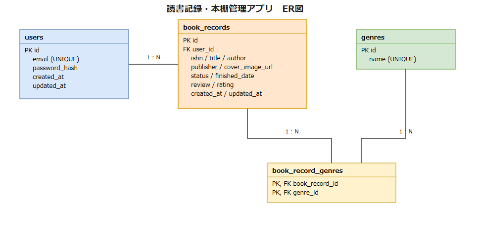

# DB設計書

| 項目 | 内容 |
|------|------|
| 作成日 | 2026-08-08 |
| 作成者 | sht |
| 版数 | v0.1 |
| 関連文書 | 基本設計書（`docs/02_design/01_basic/基本設計書.md` 6.データ構成概要） |

## 1. ER図

編集可能な元データは [`ER図.drawio`](./ER図.drawio)（draw.io / diagrams.net で開いて編集）を参照。

- users（ユーザー） 1 : N book_records（蔵書記録）
- book_records（蔵書記録） 1 : N book_record_genres、genres（ジャンル） 1 : N book_record_genres　※book_recordsとgenresは中間テーブルbook_record_genresを介した多対多

## 2. テーブル一覧

| テーブル名 | 概要 |
|-----------|------|
| users | ユーザーアカウント情報 |
| book_records | 蔵書記録（ユーザーが登録した本の記録） |
| genres | ジャンル・タグのマスタ |
| book_record_genres | book_recordsとgenresの多対多関連を表す中間テーブル |

## 3. テーブル定義（テーブル名: users）

| カラム名 | 型 | NULL許可 | 主キー | 外部キー | 説明 |
|---------|----|---------|--------|---------|------|
| id | INTEGER | - | ○ | - | 主キー、自動採番 |
| email | VARCHAR(255) | - | - | - | ログインID。一意制約あり |
| password_hash | VARCHAR(255) | - | - | - | bcryptでハッシュ化したパスワード |
| created_at | DATETIME | - | - | - | 登録日時 |
| updated_at | DATETIME | - | - | - | 更新日時 |

## 3. テーブル定義（テーブル名: book_records）

| カラム名 | 型 | NULL許可 | 主キー | 外部キー | 説明 |
|---------|----|---------|--------|---------|------|
| id | INTEGER | - | ○ | - | 主キー、自動採番 |
| user_id | INTEGER | - | - | users.id | 記録の所有ユーザー |
| isbn | VARCHAR(20) | ○ | - | - | ISBN |
| title | VARCHAR(255) | - | - | - | 書名 |
| author | VARCHAR(255) | ○ | - | - | 著者名 |
| publisher | VARCHAR(255) | ○ | - | - | 出版社名 |
| cover_image_url | TEXT | ○ | - | - | 表紙画像URL |
| status | VARCHAR(20) | - | - | - | 読書ステータス（未読／読書中／読了） |
| finished_date | DATE | ○ | - | - | 読了日。statusが「読了」の場合のみ設定 |
| review | TEXT | ○ | - | - | 感想。最大1000文字 |
| rating | INTEGER | ○ | - | - | 評価（1〜5の整数） |
| created_at | DATETIME | - | - | - | 登録日時 |
| updated_at | DATETIME | - | - | - | 更新日時 |

## 3. テーブル定義（テーブル名: genres）

| カラム名 | 型 | NULL許可 | 主キー | 外部キー | 説明 |
|---------|----|---------|--------|---------|------|
| id | INTEGER | - | ○ | - | 主キー、自動採番 |
| name | VARCHAR(50) | - | - | - | ジャンル名。一意制約あり |

## 3. テーブル定義（テーブル名: book_record_genres）

| カラム名 | 型 | NULL許可 | 主キー | 外部キー | 説明 |
|---------|----|---------|--------|---------|------|
| book_record_id | INTEGER | - | ○（複合） | book_records.id | 対象の蔵書記録 |
| genre_id | INTEGER | - | ○（複合） | genres.id | 対象のジャンル |

## 4. インデックス設計

| テーブル名 | インデックス名 | 対象カラム | 種別 |
|-----------|----------------|-----------|------|
| users | uq_users_email | email | UNIQUE |
| book_records | idx_book_records_user_id | user_id | INDEX |
| book_records | idx_book_records_status | status | INDEX |
| genres | uq_genres_name | name | UNIQUE |
| book_record_genres | pk_book_record_genres | book_record_id, genre_id | UNIQUE（複合主キー） |
| book_record_genres | idx_book_record_genres_genre_id | genre_id | INDEX |
