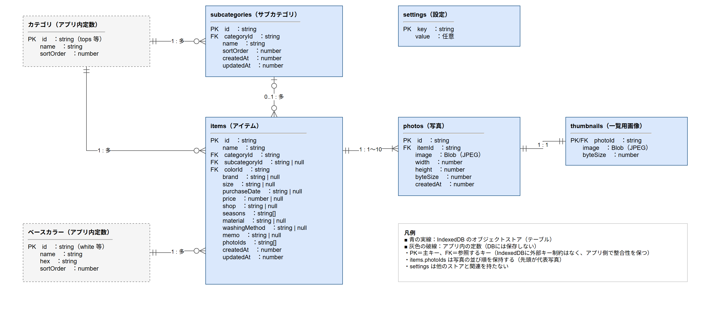

# DB設計書 共通

| 項目 | 内容 |
|------|------|
| 作成日 | 2026-11-07 |
| 作成者 | sht |
| 版数 | v0.2 |
| 関連文書 | 要件定義書 v0.4（`docs/01_requirements/要件定義書.md`）、画面詳細設計書（`docs/02_design/02_detailed/画面詳細設計書/`）、処理設計書（`docs/02_design/02_detailed/処理設計書/`）、合意事項・変更履歴（`docs/00_knowledge/合意事項・変更履歴.md`） |

### 改訂履歴

| 版数 | 日付 | 内容 |
|------|------|------|
| v0.1 | 2026-11-07 | 初版作成（1ファイルのDB設計書として作成、合意済み） |
| v0.2 | 2026-11-07 | テーブル単位でファイルを分割し、全テーブル共通の内容を本書にまとめた。内容の変更はなし |

## 1. 本書の方針
- DB設計書はテーブル単位でファイルを分けて作成する。本書は全テーブルに共通する内容（前提、ER図、テーブル一覧、コード定義、データ操作とトランザクション、整合性、容量、スキーマ定義、画面項目との対応）を定める
- 各テーブルのカラム定義・インデックス・テーブル固有の事項は、テーブルごとのファイルに記載する

## 2. 前提

| 項目 | 内容 |
|------|------|
| データベース | iPhoneのSafari内の IndexedDB（要件定義書 9章） |
| 操作ライブラリ | Dexie.js |
| データベース名 | `closet-app` |
| 用語 | 本書の「テーブル」は IndexedDB のオブジェクトストアを指す。「インデックス」はオブジェクトストアのインデックスを指す |
| 外部キー | IndexedDB には外部キー制約がないため、参照の整合性はアプリ側の処理（6章・7章）で保つ |
| 固定値 | カテゴリ・ベースカラー・季節・並び順の選択肢は変更されない値のため、DBには保存せずアプリ内の定数として持つ（5章） |
| ID | 主キーには UUID（`crypto.randomUUID()` で生成する文字列）を使う |
| 日時 | 登録日時・更新日時は、エポックミリ秒（1970年1月1日からの経過ミリ秒）の数値で保存する |
| 未入力 | 任意項目の未入力は `null` で保存する（空文字は保存しない） |
| 削除 | 論理削除は行わず、物理削除とする |

## 3. ER図
編集用の原本は `ER図.drawio`（draw.io形式）。修正時は原本を編集し、PNGを書き出し直すこと。



## 4. テーブル一覧

| テーブルID | テーブル名 | 論理名 | 概要 | ファイル | 状態 |
|-----------|-----------|--------|------|---------|------|
| T-01 | items | アイテム | 登録した服1点ごとの情報。写真はIDの並びで参照する | `T-01_items.md` | 合意済み |
| T-02 | photos | 写真 | アイテムの写真（縮小・圧縮済みの画像） | `T-02_photos.md` | 合意済み |
| T-03 | thumbnails | 一覧用画像 | 写真ごとの小さい画像。一覧表示（SC-01）で使う | `T-03_thumbnails.md` | 合意済み |
| T-04 | subcategories | サブカテゴリ | カテゴリごとのサブカテゴリ。ユーザーが編集できる | `T-04_subcategories.md` | 合意済み |
| T-05 | settings | 設定 | 並び順など、アプリの設定値をキーと値の組で保存する | `T-05_settings.md` | 合意済み |

- 写真の画像を items に含めないのは、一覧表示や絞り込みのたびに大きな画像データを読み込まないようにするため
- 一覧用画像を photos と分けるのは、一覧表示で元の大きさの画像を読み込まないようにするため（IndexedDB は1件単位で読み込むため、同じレコードに入れると両方読まれる）

## 5. コード定義（アプリ内定数）

### 5.1 カテゴリ

| id | 名称 | 表示順 |
|----|------|-------|
| tops | トップス | 1 |
| bottoms | ボトムス | 2 |
| outer | アウター | 3 |
| setup | セットアップ・スーツ | 4 |
| shoes | シューズ | 5 |
| bag | バッグ | 6 |
| hat | 帽子 | 7 |
| accessory | アクセサリー・小物 | 8 |
| other | その他 | 9 |

### 5.2 ベースカラー

| id | 名称 | 表示色 | 表示順 |
|----|------|-------|-------|
| white | 白 | #F7F7F5 | 1 |
| black | 黒 | #262628 | 2 |
| gray | グレー | #9C9CA1 | 3 |
| navy | ネイビー | #1F2F54 | 4 |
| beige | ベージュ | #D9C6A5 | 5 |
| brown | ブラウン | #7A5232 | 6 |
| khaki | カーキ | #6B6A3C | 7 |
| red | 赤 | #C0392B | 8 |
| blue | 青 | #3A74C9 | 9 |
| green | 緑 | #2E7D4F | 10 |
| yellow | 黄 | #E8C547 | 11 |
| pink | ピンク | #E8A0B4 | 12 |
| purple | 紫 | #7E57C2 | 13 |
| other | その他 | 多色のグラデーション | 14 |

### 5.3 季節

| コード | 名称 | 表示順 |
|-------|------|-------|
| spring | 春 | 1 |
| summer | 夏 | 2 |
| autumn | 秋 | 3 |
| winter | 冬 | 4 |

### 5.4 並び順

| コード | 名称 |
|-------|------|
| created_desc | 登録日が新しい順（初期値） |
| created_asc | 登録日が古い順 |
| purchase_desc | 購入日が新しい順 |
| purchase_asc | 購入日が古い順 |
| price_desc | 購入金額が高い順 |
| price_asc | 購入金額が安い順 |
| name_asc | 名前順 |

## 6. データ操作とトランザクション
複数のテーブルを更新する操作は、1つのトランザクション（読み書き）で行い、途中で失敗した場合はすべて取り消す。処理の詳細は処理設計書を参照。

| No | 操作 | 対象画面 | 対象テーブル | 処理内容 | 処理設計書 |
|----|------|---------|------------|---------|-----------|
| 1 | アイテム登録 | SC-05 | items, photos, thumbnails | 写真ごとに photos と thumbnails を追加し、その写真IDの並びを photoIds に設定して items を追加する。createdAt・updatedAt に現在日時を設定 | P-05 |
| 2 | アイテム更新 | SC-05 | items, photos, thumbnails | 追加された写真を photos・thumbnails に追加し、取り除かれた写真を photos・thumbnails から削除する。items の各項目と photoIds を更新し、updatedAt に現在日時を設定（createdAt は変更しない） | P-05 |
| 3 | アイテム削除 | SC-04（DL-04） | items, photos, thumbnails | itemId インデックスで対象アイテムの photos を取得し、対応する thumbnails とともに削除してから items を削除する | P-06 |
| 4 | サブカテゴリ追加 | SC-08（DL-05） | subcategories | 同じカテゴリの件数が30件未満であることを確認し、sortOrder にカテゴリ内の最大値＋10を設定して追加する。名前の重複は [categoryId+name] の一意制約でも検出する | P-07 |
| 5 | サブカテゴリ名称変更 | SC-08（DL-05） | subcategories | name と updatedAt を更新する。items は ID で参照しているため更新しない | P-07 |
| 6 | サブカテゴリ並び替え | SC-08 | subcategories | 入れ替える2件の sortOrder の値を交換し、updatedAt を更新する | P-08 |
| 7 | サブカテゴリ削除 | SC-08（DL-06） | items（読取）, subcategories | subcategoryId インデックスで該当アイテムが0件であることを同じトランザクション内で確認してから削除する。1件以上ある場合は削除しない | P-09 |
| 8 | 並び順の保存 | SC-03 | settings | `itemSortOrder` を更新する | P-03 |
| 9 | 保存容量の取得 | SC-06 | photos, thumbnails | 全件の byteSize を合計する | P-10 |
| 10 | 初期サブカテゴリの投入 | 起動時 | subcategories, settings | 初期サブカテゴリ（T-04 5章）を登録し、`subcategoriesSeeded` に true を保存する | P-01 |

## 7. 整合性のルール（アプリ側で保証する）
- items.photoIds の各IDに対応する photos・thumbnails が必ず存在すること。photos.itemId はそのアイテムを指すこと
- items.subcategoryId は、null または items.categoryId と同じカテゴリに属する subcategories.id であること
- items.photoIds は1件以上10件以下であること
- サブカテゴリは、参照しているアイテムがある間は削除しないこと

## 8. 容量の見積もり

| 対象 | 1件あたりの目安 | 件数（100アイテム×平均3枚） | 合計 |
|------|---------------|---------------------------|------|
| photos（長辺1280px JPEG） | 約250KB | 300件 | 約75MB |
| thumbnails（400px JPEG） | 約25KB | 300件 | 約7.5MB |
| items・subcategories・settings | 1KB未満 | 約150件 | 1MB未満 |
| 合計 | | | 約83MB |

- 要件定義書の目安（100点×平均3枚で100MB程度以内）を満たす
- 最大想定（300アイテム×平均3枚）では約250MB。iOS Safariのホーム画面に追加したWebアプリは端末の空き容量に応じて大きな容量を使えるが、書き込み失敗時は MSG-E11 を表示する（画面詳細設計書 共通仕様 6章）

## 9. スキーマ定義とバージョン管理

Dexie.js でのスキーマ定義（参考）。各インデックスの用途はテーブルごとのファイルを参照。

```ts
db.version(1).stores({
  items: 'id, categoryId, subcategoryId, createdAt',
  photos: 'id, itemId',
  thumbnails: 'photoId',
  subcategories: 'id, categoryId, &[categoryId+name], [categoryId+sortOrder]',
  settings: 'key',
});
```

- スキーマを変更する場合は、Dexie.js の `db.version(n)` を1つ上げ、既存データの移行処理（upgrade）を記述する
- 既存のバージョン定義は削除せずに残す
- 変更内容は該当するテーブルのファイルと本書の改訂履歴に反映する

## 10. 画面項目との対応

| 画面項目（要件定義書 5.2） | テーブル.カラム |
|--------------------------|----------------|
| 写真 | items.photoIds → photos.image（詳細）／thumbnails.image（一覧） |
| 名前 | items.name |
| カテゴリ | items.categoryId |
| サブカテゴリ | items.subcategoryId → subcategories.name |
| ベースカラー | items.colorId |
| ブランド | items.brand |
| サイズ | items.size |
| 購入日 | items.purchaseDate |
| 購入金額 | items.price |
| 購入店舗 | items.shop |
| 季節 | items.seasons |
| 素材 | items.material |
| 洗濯方法 | items.washingMethod |
| メモ | items.memo |
| 登録日時・更新日時 | items.createdAt、items.updatedAt |
| 並び順（SC-03） | settings（key = itemSortOrder） |

## 11. 確認事項
2026-11-07 のレビューにて、以下の全件について合意済み（v0.1 時点）。

| No | 内容 | 該当箇所 |
|----|------|---------|
| 1 | カテゴリ・ベースカラー・季節・並び順はDBに保存せず、アプリ内の定数とする（変更する場合はアプリの更新で対応） | 2章、5章 |
| 2 | 写真・一覧用画像・アイテム情報を別々のテーブルに分ける（一覧表示を速くするため） | 4章 |
| 3 | 一覧用画像は400pxの正方形とする | T-03 |
| 4 | ブランドは専用テーブルを持たず、登録済みアイテムから作る | T-01 |
| 5 | 任意項目の未入力は null で保存し、削除は物理削除とする | 2章 |
| 6 | 初期サブカテゴリは初回起動時に1度だけ登録し、ユーザーがすべて削除しても再登録しない | T-04 |
| 7 | 並び順の設定はブラウザの localStorage ではなく、IndexedDB の settings に保存する（保存先を1つにまとめるため） | T-05 |
